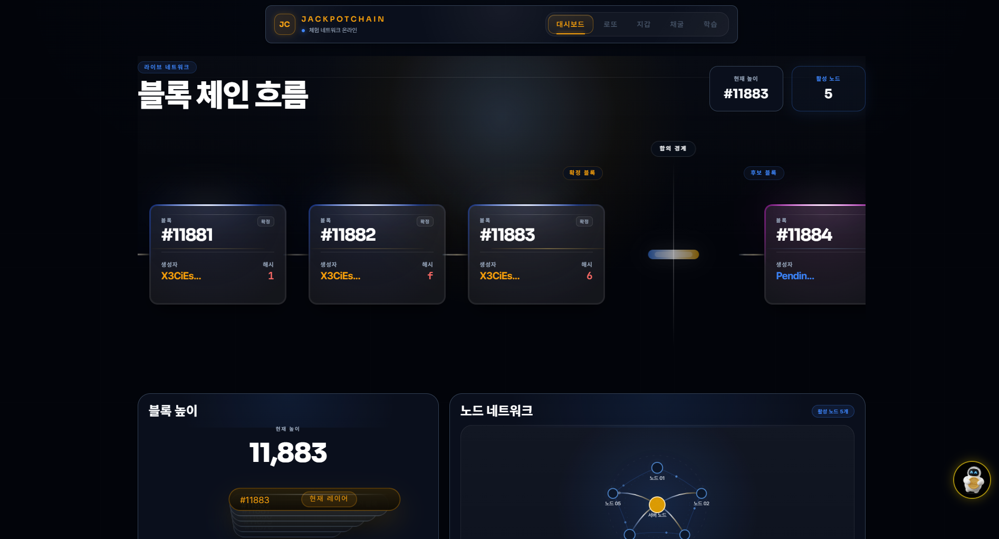
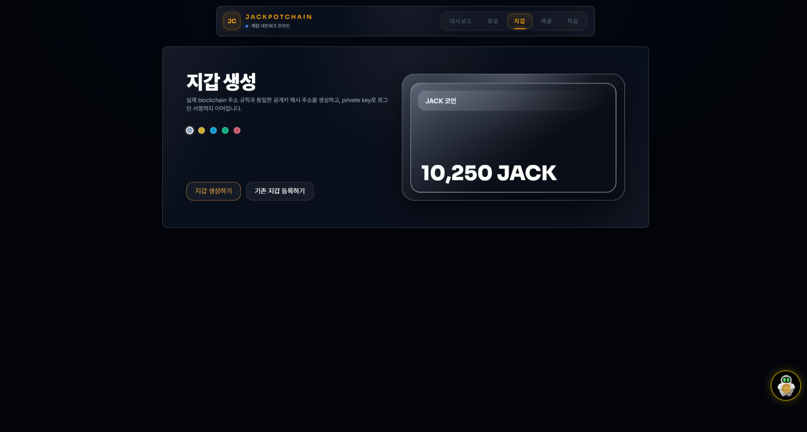
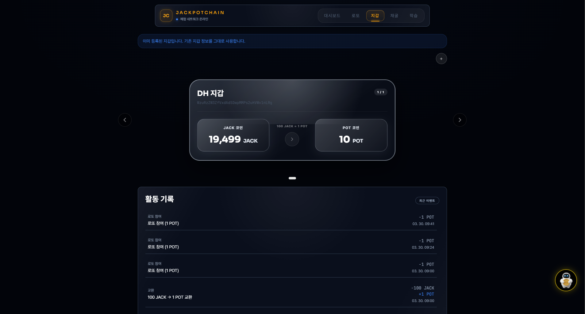
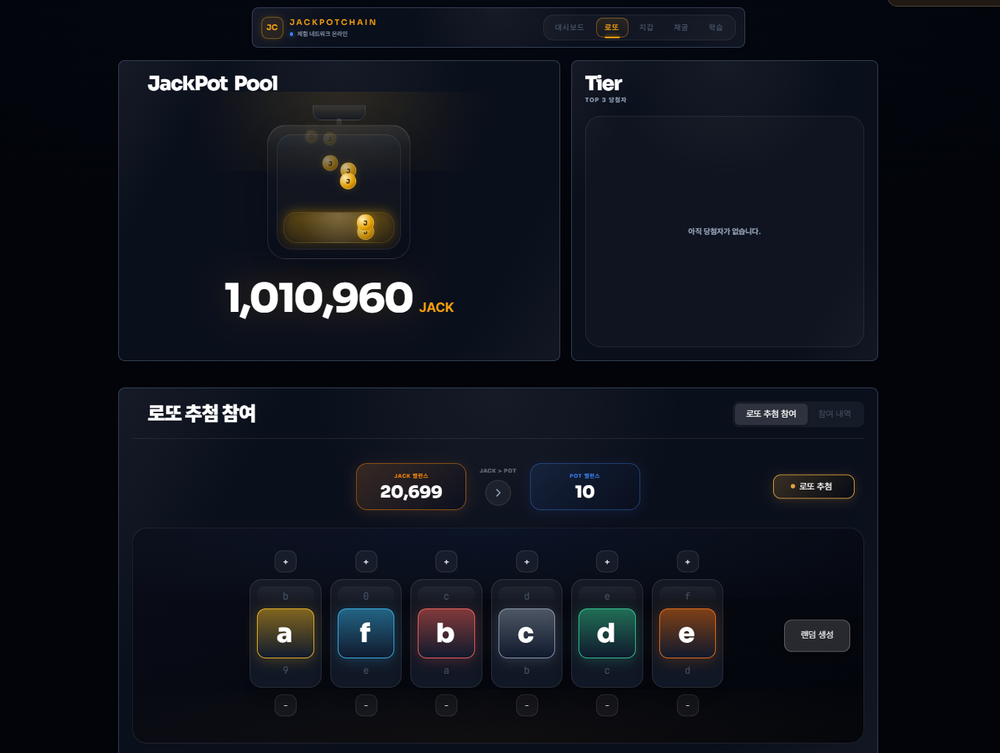
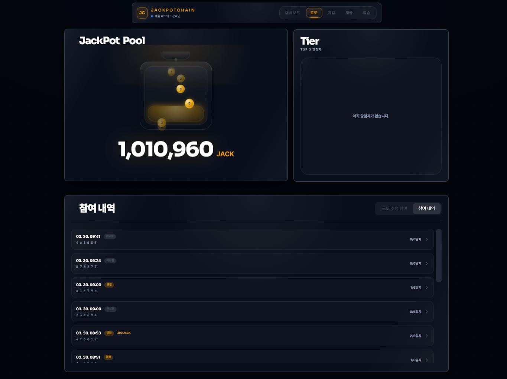
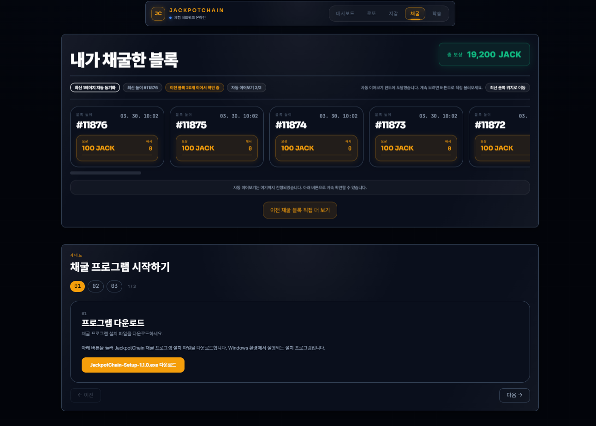
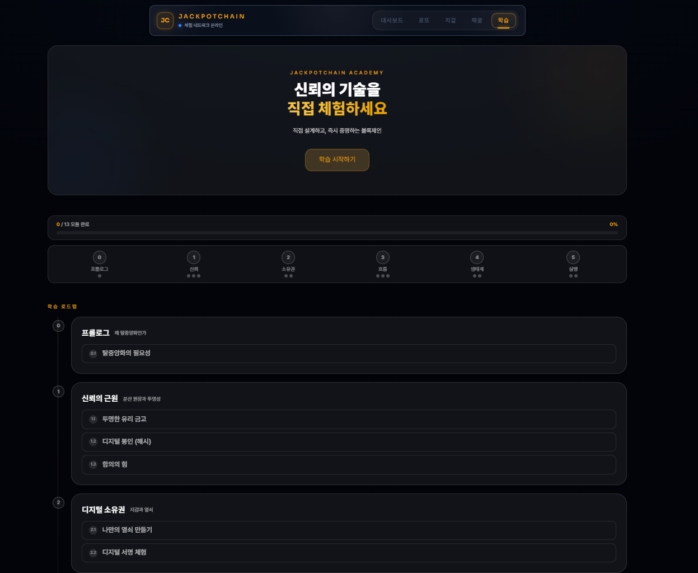
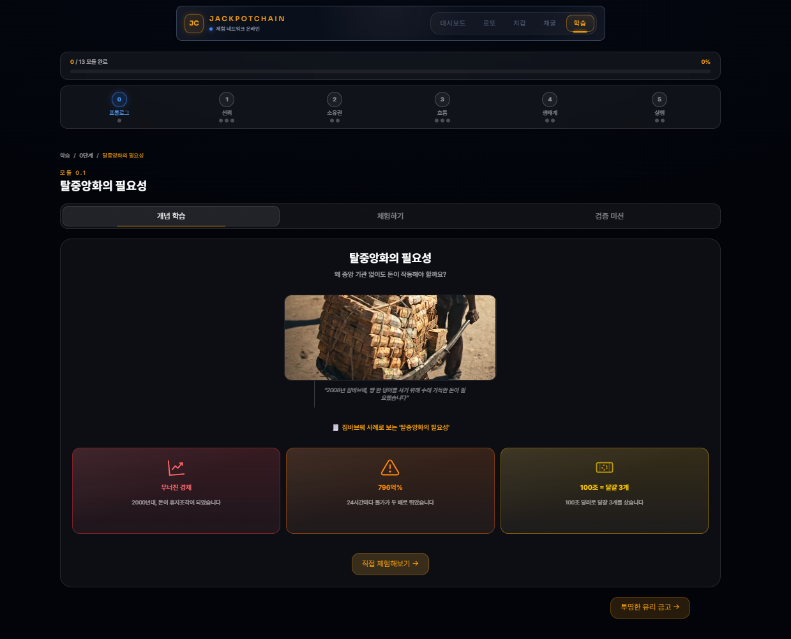
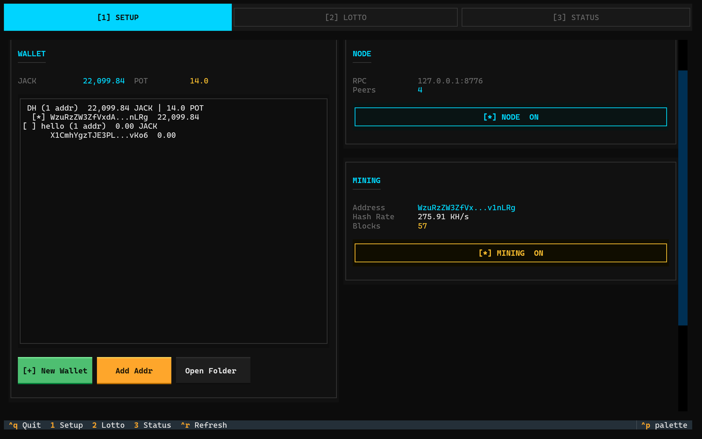
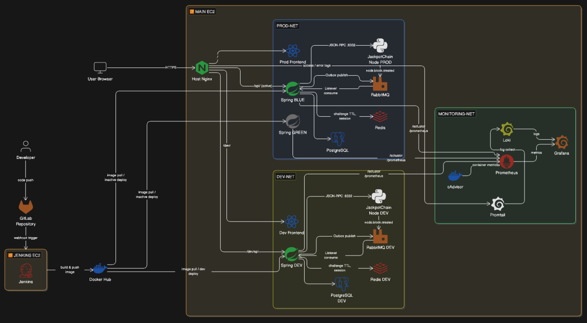

# 🎰 JackpotChain
### 직접 만든 블록체인 위에서 즐기는 온체인 로또 서비스


<br>

<div align="center">

  
  <br><br>
  <b>"블록체인을 직접 만들고, 그 위에서 운영한다."</b><br>
  Python으로 구현한 UTXO 블록체인과 Spring Boot 백엔드, React 프론트엔드로 구성된<br>
  풀스택 온체인 로또 서비스
</div>

---

## 🚀 핵심 기능

### 1. 지갑 생성 및 관리

브라우저에서 직접 키페어를 생성하고, 개인키는 IndexedDB에 암호화 저장합니다. 서버에는 공개키와 주소만 전송됩니다.

| 지갑 생성 | 잔액 조회 및 토큰 교환 |
| :---: | :---: |
|  |  |
| 브라우저에서 키페어 직접 생성 | JACK / POT 잔액 조회와 토큰 교환 및 활동 내역 확인 |


<br>

### 2. 온체인 로또 (Commit-Reveal)

블록 해시를 기반으로 당첨 결과가 결정됩니다. Commit 트랜잭션을 블록체인에 기록한 후, 이후 블록들의 해시 마지막 자리로 당첨 여부를 판정합니다.

| 로또 참가 (Commit) | 결과 확인 (Claim) |
| :---: | :---: |
|  |  |
| 6자리 숫자(0x0~0xF) 선택 후 참가비 지불 | N+18 블록 이후 결과 확정, Claim으로 보상 수령 |

**등급별 보상**

| 등급 | 일치 | 보상 |
|:---:|:---:|:---|
| 1등 | 6개 | 잭팟 풀 50% |
| 2등 | 5개 | 100,000 JACK |
| 3등 | 4개 | 20,000 JACK |
| 4등 | 3개 | 2,000 JACK |
| 5등 | 2개 | 300 JACK |
| 6등 | 1개 | 1 POT (참가비 환불) |

<br>

### 3. 채굴 모니터링

TUI 노드 또는 Docker로 실행 중인 채굴자의 현황을 대시보드에서 확인합니다.

| 채굴 대시보드 |
| :---: |
|  |

<br>

### 4. 블록체인 학습

블록체인 동작 원리를 인터랙티브하게 학습할 수 있습니다.

| 블록체인 학습 | 블록체인 학습 상세 |
| :---: | :---: |
|  |  |

---

## 🔗 블록체인 기술 개요 (JackpotChain Node)

Bitcoin을 참고한 Python 기반 UTXO 블록체인을 직접 구현했습니다.

### 핵심 구현 사항

- **UTXO 모델**: 잔액을 미사용 트랜잭션 출력으로 관리 (Bitcoin 방식)
- **PoW 채굴**: 난이도 자동 조정 + 체인 재편성(Reorg) 처리
- **Commit-Reveal 로또**: 블록 해시를 무작위성의 원천으로 사용하는 온체인 복권
- **P2P 네트워킹**: asyncio 기반 피어 디스커버리 및 블록 전파
- **JSON-RPC 서버**: 백엔드와 통신하는 API 서버 (포트 8776)
- **Webhook**: 새 블록 수신 시 Spring 백엔드에 HTTP 이벤트 전송

### 트랜잭션 버전

| 버전 | 타입 |
|:---:|:---|
| 1 | 일반 송금 |
| 2 | JACK → POT 교환 |
| 3 | 로또 Commit |
| 5 | 로또 Claim |

### 참가비 분배

```
참가비 1 POT
├── 80% → 잭팟 풀 적립
├── 19% → 소각 (디플레이션)
└──  1% → 채굴자 보상
```

### TUI (터미널 UI)

Windows 설치 파일(`.exe`) 또는 CLI로 로컬 채굴 노드를 운영할 수 있습니다.

```
F1 Dashboard  F2 Wallet  F3 Mining  F4 Lotto  F5 Claims  F6 Network
```



---

## 🛠 기술 스택

### 시스템 아키텍처



### 상세

| 분류 | 기술 | 버전 |
|:---:|:---|:---|
| **Frontend** | React, TypeScript, Vite, Zustand, Tailwind CSS | React 19, Vite 6 |
| **Backend** | Spring Boot, Spring Security, JPA, Flyway | Spring Boot 3.5 |
| **Blockchain** | Python, asyncio, UTXO, PoW, JSON-RPC | Python 3.12 |
| **Database** | PostgreSQL, Redis | PostgreSQL 16, Redis 7 |
| **Message Broker** | RabbitMQ | RabbitMQ 3 |
| **Infra** | AWS EC2, Docker, Nginx | |
| **CI/CD** | Jenkins, Docker Hub | |
| **Monitoring** | Prometheus, Grafana, Loki, Promtail | |

---

## 📂 프로젝트 구조

```
S14P21E202/
├── BE-ssatto/          # Spring Boot REST API 서버
├── FE-ssatto/          # React 프론트엔드
├── blockchain/         # Python UTXO 블록체인 노드
├── nginx/              # Nginx 설정 (upstream, server block)
├── scripts/            # 배포 및 장애 대응 쉘 스크립트
├── monitoring/         # Prometheus, Grafana, Loki 설정
├── docker-compose.prod.yml
├── docker-compose.dev.yml
├── docker-compose.local.yml
└── .env.example        # 환경변수 포맷 예시
```

---

## ⚡ 빠른 시작 (로컬)

```bash
# 1. 환경변수 파일 준비
cp .env.example .env.local
# .env.local 편집 후

# 2. 전체 스택 실행
docker compose -f docker-compose.local.yml --env-file .env.local up -d
```

| 서비스 | URL |
|--------|-----|
| 프론트엔드 | http://localhost:13000 |
| 백엔드 API | http://localhost:8080 |
| RabbitMQ 관리 | http://localhost:15672 |
| PostgreSQL | localhost:15432 |

---

## 🚢 배포 구조 (Blue/Green)

```
Nginx (EC2 호스트)
  └── upstream.conf 로 트래픽 방향 결정
       ├── spring-blue  (포트 8090)  ← 현재 active
       └── spring-green (포트 8092)  ← 대기
```

Jenkins가 새 이미지를 빌드·푸시하면 `deploy-prod.sh`가 대기 컨테이너를 기동하고, health check 통과 후 `switch-color.sh`로 nginx upstream을 전환합니다. 장애 시 `rollback.sh`로 즉시 이전 color로 복귀합니다.

자세한 내용은 [배포 가이드](#) 섹션 참조.

---

## 📚 상세 문서

| 문서 | 경로 |
|------|------|
| 백엔드 | [BE-ssatto/README.md](BE-ssatto/README.md) |
| 프론트엔드 | [FE-ssatto/README.md](FE-ssatto/README.md) |
| 블록체인 노드 | [blockchain/README.md](blockchain/README.md) |

---

## 👥 팀 E202

SSAFY 14기 자율 프로젝트

| 이름 | 역할 | 담당 |
|------|------|------|
| 양한빈 | - | Frontend, Blockchain |
| 이민수 | - | Frontend, Blockchain |
| 이동휘 | - | Backend, Blockchain |
| 임경수 | - | Backend, Blockchain |
| 장주윤 | - | Backend, Infra, Blockchain |
