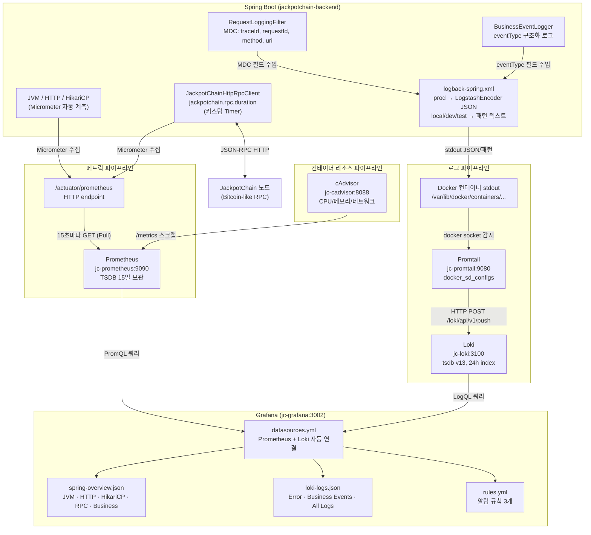

# 모니터링 학습 — Prometheus · Grafana · Loki · Micrometer

> 작성일: 2026-03-25 / 업데이트: 2026-03-26
> 기준: docker-compose.monitoring.yml, monitoring/ 설정 파일, BE-ssatto 실제 코드

---

## 0. 전체 아키텍처 다이어그램



---

## 1. 왜 모니터링이 필요한가

운영 서버에서 다음 질문들에 즉시 답할 수 있어야 한다.

| 상황 | 질문 |
|------|------|
| 장애 발생 | 언제, 어떤 서비스가, 어떤 이유로 죽었는가? |
| 성능 저하 | 응답이 느린 구간이 DB인가, RPC인가, JVM인가? |
| 비즈니스 이상 | 오늘 로또 commit이 갑자기 0건인 이유가 뭔가? |
| 용량 계획 | 메모리/커넥션 풀이 앞으로 언제 고갈되는가? |

코드 로그만으로는 집계와 시각화가 불가능하고, 메트릭만으로는 원인 추적이 불가능하다.
**이 프로젝트는 메트릭(Prometheus) + 로그(Loki) + 시각화(Grafana)를 조합해 두 관점을 동시에 확보한다.**

---

## 2. 전체 구성 한 줄 요약

```
Spring Boot  ──메트릭 노출──▶  Prometheus  ──▶  Grafana (대시보드 · 알림)
    │                                               ▲
    │ stdout 로그 (JSON)                            │
    ▼                                               │
컨테이너 로그  ──수집──▶  Promtail  ──전송──▶  Loki  ──쿼리──┘

Docker 컨테이너  ──CPU/메모리──▶  cAdvisor  ──스크랩──▶  Prometheus
```

---

## 3. 기술 스택 구성 요소 & 역할

### 3-1. Prometheus — 메트릭 수집기

**무엇인가**
시계열 데이터베이스. 대상 서버에서 주기적으로(15초) `GET /actuator/prometheus`를 호출해 수치를 긁어간다.

**왜 "긁어오기(Pull)"인가**
Push 방식이면 각 서비스가 Prometheus 주소를 알아야 하고, 서비스가 죽으면 데이터가 안 온다.
Pull 방식이면 Prometheus가 스케줄대로 수집하고, 응답이 없으면 "down" 상태로 즉시 감지된다.

**저장 형식**
```
{메트릭명}{라벨들} 값 타임스탬프

예시:
jackpotchain_rpc_duration_seconds_count{application="jackpotchain-backend",method="getblockcount",outcome="success"} 42 1711300000
http_server_requests_seconds_count{status="200",uri="/api/v1/lotto/commit"} 7 1711300000
```

**이 프로젝트의 실제 scrape targets (`monitoring/prometheus/prometheus.yml`)**

```yaml
global:
  scrape_interval: 15s

scrape_configs:
  # 로컬 개발 환경 (docker-compose.local.yml)
  - job_name: 'spring-local'
    metrics_path: /actuator/prometheus
    static_configs:
      - targets: ['host.docker.internal:8080']
        labels:
          env: local

  # Dev 환경
  - job_name: 'spring-dev'
    metrics_path: /actuator/prometheus
    static_configs:
      - targets: ['jc-spring-dev:8080']
        labels:
          env: dev

  # Prod Blue/Green
  - job_name: 'spring-blue'
    metrics_path: /actuator/prometheus
    static_configs:
      - targets: ['jc-spring-blue:8080']
        labels:
          env: prod
          color: blue

  - job_name: 'spring-green'
    metrics_path: /actuator/prometheus
    static_configs:
      - targets: ['jc-spring-green:8080']
        labels:
          env: prod
          color: green
```

> **주의**: cAdvisor는 docker-compose에 포함되어 있지만 현재 prometheus.yml에 별도 scrape job이 없다.
> cAdvisor 메트릭(`container_memory_usage_bytes` 등)을 Prometheus로 수집하려면 `cadvisor` job을 추가해야 한다.

**PromQL — 쿼리 언어 예시**

```promql
# RPC p95 응답 시간 (5분 윈도우)
histogram_quantile(0.95,
  sum(rate(jackpotchain_rpc_duration_seconds_bucket[5m])) by (le, method)
)

# HTTP 5xx 에러율 (%)
sum(rate(http_server_requests_seconds_count{status=~"5.."}[5m]))
/
sum(rate(http_server_requests_seconds_count[5m])) * 100

# 최근 2분간 로또 commit 요청 수/초
rate(http_server_requests_seconds_count{uri="/api/v1/lotto/commit",status="200"}[2m])
```

---

### 3-2. Micrometer — Spring Boot 메트릭 계측기

**무엇인가**
코드 안에서 "측정"을 담당하는 라이브러리. JVM, HTTP 서버, DB 커넥션 풀을 자동으로 계측하고,
개발자가 원하는 비즈니스 지점에 직접 계측을 추가할 수 있다.

**어떻게 노출되는가**

```
build.gradle:
  runtimeOnly 'io.micrometer:micrometer-registry-prometheus'

application.yml:
  management.endpoints.web.exposure.include: health,info,prometheus
```

→ Micrometer가 JVM/HTTP/HikariCP를 자동 계측
→ micrometer-registry-prometheus가 Prometheus 포맷으로 변환
→ `/actuator/prometheus`에서 노출
→ Prometheus가 15초마다 긁어감

**자동 계측되는 메트릭 목록**

| 카테고리 | 메트릭 이름 | 의미 |
|---------|------------|------|
| JVM | `jvm_memory_used_bytes` | Heap/Non-Heap 사용량 |
| JVM | `jvm_memory_max_bytes` | Heap 최대 용량 |
| JVM | `jvm_threads_live_threads` | 활성 스레드 수 |
| JVM | `jvm_threads_daemon_threads` | 데몬 스레드 수 |
| JVM | `jvm_gc_pause_seconds` | GC 정지 시간 (action, cause 라벨) |
| HTTP | `http_server_requests_seconds` | 요청 수, 지연 시간 (histogram) |
| HikariCP | `hikaricp_connections_active` | 현재 사용 중인 DB 커넥션 수 |
| HikariCP | `hikaricp_connections_pending` | 커넥션 대기 중인 요청 수 |
| HikariCP | `hikaricp_connections_idle` | 유휴 커넥션 수 |
| HikariCP | `hikaricp_connections_acquire_seconds` | 커넥션 획득 대기 시간 (histogram) |

**직접 추가한 커스텀 메트릭 — RPC Timer (`JackpotChainHttpRpcClient.java`)**

```java
// invoke() 메서드 내부
private static final String RPC_DURATION_METRIC = "jackpotchain.rpc.duration";
private static final long RPC_WARN_THRESHOLD_MS = 1_000L;  // 1초 초과 시 WARN 로그

Timer.Sample sample = Timer.start(meterRegistry);
String outcome = "success";
try {
    // HTTP JSON-RPC 호출 수행
} catch (BusinessException e) {
    outcome = "rpc_error";
    throw e;
} catch (RestClientException | IllegalArgumentException e) {
    outcome = "http_error";
    throw new BusinessException(ErrorCode.BLOCKCHAIN_RPC_FAILED, e);
} finally {
    sample.stop(Timer.builder(RPC_DURATION_METRIC)
        .description("JackpotChain RPC call duration")
        .tag("method", method)      // RPC 메서드명
        .tag("outcome", outcome)    // success | rpc_error | http_error
        .register(meterRegistry));
}
```

**계측되는 RPC 메서드 목록**

| 메서드 | 설명 |
|--------|------|
| `getblockcount` | 현재 블록 높이 |
| `getblockchaininfo` | 블록체인 요약 정보 |
| `getbalances` | 주소 기준 JACK/POT 잔액 |
| `listunspent` | 주소 기준 UTXO 목록 |
| `listpoolunspent` | 잭팟 풀 UTXO 목록 |
| `getblockhash` | 블록 높이 → 해시 |
| `getblock` | 블록 상세 정보 (verbosity 1 or 2) |
| `getlottoinfo` | 로또 개요 정보 |
| `getjackpotpool` | 잭팟 풀 상태 |
| `getpeerinfo` | 연결된 피어 목록 |
| `getmempoolinfo` | mempool 트랜잭션 수 |
| `lottocheckresult` | 로또 결과 조회 |
| `getexchangeinfo` | 교환 규칙 조회 |
| `getrawmempool` | mempool 상세 트랜잭션 목록 |
| `grantonboardingreward` | 신규 지갑 1 POT 지급 |
| `sendrawtransaction` | 서명된 TX 제출 |

→ 이 코드 한 줄로 `/actuator/prometheus`에 아래 메트릭이 자동 생성됨:

```
jackpotchain_rpc_duration_seconds_count{method="getblockcount",outcome="success"} 42
jackpotchain_rpc_duration_seconds_sum{method="getblockcount",outcome="success"}  0.38
jackpotchain_rpc_duration_seconds_bucket{method="getblockcount",outcome="success",le="0.005"} 5
jackpotchain_rpc_duration_seconds_bucket{method="getblockcount",outcome="success",le="0.01"}  20
...
```

`_count`는 호출 횟수, `_sum`은 누적 시간, `_bucket`은 분포(히스토그램).
이 세 가지를 합쳐서 `histogram_quantile(0.95, ...)` 로 p95 지연 시간을 계산할 수 있다.

---

### 3-3. Loki — 로그 집계 저장소

**무엇인가**
Prometheus와 같은 구조로 설계된 로그 저장소. Prometheus가 메트릭을 라벨로 인덱싱하듯,
Loki는 **로그를 라벨로만 인덱싱하고 본문은 압축 보관**한다.

**Elasticsearch와 차이**
Elasticsearch는 로그 본문 전체를 인덱싱 → 저장 공간이 크고 인프라가 무겁다.
Loki는 라벨만 인덱싱 → 가볍고 Grafana와 완벽하게 통합된다.
대신 full-text 검색 성능은 Elasticsearch가 낫다.

**실제 설정 (`monitoring/loki/config.yml`)**

```yaml
auth_enabled: false

server:
  http_listen_port: 3100

common:
  path_prefix: /loki
  storage:
    filesystem:
      chunks_directory: /loki/chunks
      rules_directory: /loki/rules
  replication_factor: 1
  ring:
    kvstore:
      store: inmemory   # 단일 인스턴스 — ZooKeeper/etcd 불필요

schema_config:
  configs:
    - from: 2026-01-01
      store: tsdb           # 인덱스 저장 방식
      object_store: filesystem
      schema: v13
      index:
        prefix: index_
        period: 24h         # 하루 단위 인덱스 파일
```

**LogQL — 로그 쿼리 언어 예시**

```logql
# 백엔드 에러 로그만 조회
{container=~"jc-backend.*"} | json | level="ERROR"

# eventType이 LOTTO_COMMIT_SUBMITTED인 로그만
{container=~"jc-backend.*"} | json | eventType="LOTTO_COMMIT_SUBMITTED"

# 특정 traceId로 요청 전체 추적
{container=~"jc-backend.*"} | json | traceId="9a7c4d7b"

# 최근 5분간 에러 발생 횟수
count_over_time(
  {container=~"jc-backend.*"} | json | level="ERROR" [5m]
)
```

---

### 3-4. Promtail — 로그 수집 에이전트

**무엇인가**
컨테이너에서 발생하는 로그를 수집해 Loki로 전송하는 에이전트.
Prometheus가 메트릭을 "긁어오는" 것과 반대로, Promtail은 로그를 "밀어넣는다."

**실제 설정 (`monitoring/promtail/config.yml`)**

```yaml
server:
  http_listen_port: 9080

clients:
  - url: http://loki:3100/loki/api/v1/push

scrape_configs:
  - job_name: docker-containers
    docker_sd_configs:
      - host: unix:///var/run/docker.sock   # Docker 소켓에 직접 접근
        refresh_interval: 5s
    relabel_configs:
      - source_labels: [__meta_docker_container_name]
        regex: "/(.*)"
        target_label: container             # 라벨: container="jc-backend-local"
      - source_labels: [__meta_docker_container_label_com_docker_compose_service]
        target_label: service               # 라벨: service="backend"
      - source_labels: [__meta_docker_container_label_com_docker_compose_project]
        target_label: compose_project       # 라벨: compose_project="jackpotchain"
      - source_labels: [__meta_docker_container_id]
        target_label: container_id
    pipeline_stages:
      - json:
          expressions:
            level: level          # Loki 라벨로 등록됨
            eventType: eventType  # Loki 라벨로 등록됨
            traceId: traceId      # 라벨 미등록 — 본문에서만 검색
            requestId: requestId  # 라벨 미등록 — 본문에서만 검색
            walletAddress: walletAddress  # 라벨 미등록
            txId: txId            # 라벨 미등록
      - labels:
          level:        # ← 이것만 Loki 인덱스 라벨이 됨
          eventType:    # ← 이것만 Loki 인덱스 라벨이 됨
      - output:
          source: message
```

**핵심**: `docker_sd_configs`로 모든 컨테이너 로그를 자동 발견하고,
JSON 파이프라인으로 `level`, `eventType` 필드만 Loki **인덱스 라벨**로 변환한다.
`traceId`, `requestId`, `walletAddress`, `txId`는 JSON에서 추출되지만 라벨이 아닌 **본문 필드**로 보관된다.

> **라벨 vs 본문의 차이**
> - 라벨(`level`, `eventType`): Loki가 인덱스로 관리 → `{level="ERROR"}` 검색이 빠름
> - 본문(`traceId` 등): 압축 보관 → `| json | traceId="9a7c"` 검색 시 전체 스캔 (느림)
> traceId 검색이 자주 필요하면 라벨로 올리는 것을 고려할 수 있지만, 카디널리티가 너무 높아 비효율적.

**Spring Boot 로그가 JSON이 되는 이유**

```xml
<!-- BE-ssatto/src/main/resources/logback-spring.xml -->

<!-- local, dev, test: 사람이 읽기 쉬운 패턴 텍스트 -->
<springProfile name="local,dev,test">
    <root level="INFO">
        <appender-ref ref="STDOUT_PATTERN"/>
        <!-- 패턴: timestamp level [thread] logger traceId= requestId= method= uri= eventType= - message -->
    </root>
</springProfile>

<!-- prod: Promtail이 파싱할 수 있는 JSON 한 줄 -->
<springProfile name="prod">
    <root level="INFO">
        <appender-ref ref="STDOUT_JSON"/>
        <!-- LogstashEncoder: MDC 필드 전체를 JSON 키로 자동 포함 -->
        <!-- customFields: {"service":"jackpotchain-backend","profile":"prod"} -->
    </root>
</springProfile>
```

`prod` 프로파일에서는 `LogstashEncoder`가 로그를 JSON 한 줄로 출력한다.
이 JSON을 Promtail이 수집하면 `level`, `eventType`, `traceId` 등이 각 필드로 추출된다.

---

### 3-5. MDC (Mapped Diagnostic Context) — 요청 추적

**무엇인가**
스레드 로컬 저장소. HTTP 요청이 시작될 때 고유 ID를 넣어두면,
해당 요청을 처리하는 모든 코드에서 자동으로 로그에 ID가 붙는다.

**실제 코드 (`RequestLoggingFilter.java`)**

```java
@Component
public class RequestLoggingFilter extends OncePerRequestFilter {

    private static final String REQUEST_ID_HEADER = "X-Request-Id";

    @Override
    protected void doFilterInternal(...) {
        String requestId = LoggingUtils.resolveRequestId(request.getHeader(REQUEST_ID_HEADER));
        String traceId = LoggingUtils.newTraceId();

        try {
            MDC.put(LoggingFields.REQUEST_ID, requestId);
            MDC.put(LoggingFields.TRACE_ID, traceId);
            MDC.put(LoggingFields.METHOD, request.getMethod());
            MDC.put(LoggingFields.URI, request.getRequestURI());
            response.setHeader(REQUEST_ID_HEADER, requestId);  // 응답에도 requestId 포함
            filterChain.doFilter(request, response);
        } finally {
            // MDC.clear() 대신 각 필드를 개별 remove — 다른 필터가 세팅한 MDC를 안전하게 보존
            MDC.remove(LoggingFields.REQUEST_ID);
            MDC.remove(LoggingFields.TRACE_ID);
            MDC.remove(LoggingFields.METHOD);
            MDC.remove(LoggingFields.URI);
        }
    }
}
```

> `MDC.clear()` 대신 `MDC.remove()`를 쓰는 이유: 다른 필터나 라이브러리가 세팅한 MDC 필드를 실수로 지우지 않기 위해.

**결과 로그 (prod 환경, JSON)**

```json
{
  "timestamp": "2026-03-26T14:30:01.123+09:00",
  "level": "INFO",
  "service": "jackpotchain-backend",
  "profile": "prod",
  "traceId": "9a7c4d7b",
  "requestId": "f6f2bb10-ef07",
  "eventType": "LOTTO_COMMIT_SUBMITTED",
  "uri": "/api/v1/lotto/commit",
  "method": "POST",
  "walletAddress": "jack1abc...",
  "txId": "deadbeef...",
  "message": "lotto commit submitted"
}
```

이 한 줄에서 Loki는 `level`, `eventType`을 라벨로 인덱싱하고,
나머지 필드는 본문으로 압축 보관한다.

---

### 3-6. BusinessEventLogger — 핵심 이벤트 명시적 기록

**왜 AOP 자동 로깅을 안 쓰는가**
AOP로 모든 메서드를 자동 로깅하면 잡음이 너무 많아진다.
"무엇을 수집할지"가 코드에 명시되지 않아 Loki에서 검색 기준이 흐려진다.

**실제 코드 (`BusinessEventLogger.java`)**

```java
public final class BusinessEventLogger {
    private static final Logger log = LoggerFactory.getLogger(BusinessEventLogger.class);

    public static void info(LoggingEventType eventType, String message, Map<String, ?> fields) {
        Map<String, Object> enrichedFields = new LinkedHashMap<>();
        enrichedFields.put(LoggingFields.EVENT_TYPE, eventType.name());  // eventType MDC 주입
        enrichedFields.putAll(fields);
        LoggingUtils.withFields(enrichedFields, () -> log.info(message));
    }
}
```

**이 프로젝트의 실제 이벤트 타입 (`LoggingEventType.java`)**

```java
public enum LoggingEventType {
    // 정상 비즈니스 이벤트 (INFO)
    AUTH_TOKEN_ISSUED,
    WALLET_REGISTERED,
    WALLET_ONBOARDING_REWARD_GRANTED,   // 신규 지갑 1 POT 지급
    EXCHANGE_TRANSACTION_SUBMITTED,
    LOTTO_COMMIT_SUBMITTED,
    LOTTO_CLAIM_SUBMITTED,
    JACKPOTCHAIN_TRANSACTION_SUBMITTED,

    // 에러/경고 이벤트 (WARN/ERROR)
    BUSINESS_EXCEPTION,                 // 비즈니스 예외 (4xx 계열)
    VALIDATION_EXCEPTION,               // 입력값 검증 실패
    UNHANDLED_EXCEPTION,                // 처리되지 않은 예외 (5xx)
    JACKPOTCHAIN_RPC_FAILURE,           // RPC 호출 실패 (ERROR)
    JACKPOTCHAIN_RPC_SLOW               // RPC 1초 초과 (WARN)
}
```

**사용 예시**

```java
// AuthService: 토큰 발급 시
BusinessEventLogger.info(LoggingEventType.AUTH_TOKEN_ISSUED, "token issued",
    LoggingUtils.fields("walletAddress", address));

// WalletService: 지갑 등록 시
BusinessEventLogger.info(LoggingEventType.WALLET_REGISTERED, "wallet registered",
    LoggingUtils.fields("walletAddress", address));

// WalletService: 온보딩 보상 지급 시
BusinessEventLogger.info(LoggingEventType.WALLET_ONBOARDING_REWARD_GRANTED, "onboarding reward granted",
    LoggingUtils.fields("walletAddress", address));

// LottoService.commit()
BusinessEventLogger.info(LoggingEventType.LOTTO_COMMIT_SUBMITTED, "lotto commit submitted",
    LoggingUtils.fields("txId", txId, "walletAddress", fromAddress));

// LottoService.claim()
BusinessEventLogger.info(LoggingEventType.LOTTO_CLAIM_SUBMITTED, "lotto claim submitted",
    LoggingUtils.fields("txId", claimTxId, "walletAddress", fromAddress));

// ExchangeService.exchange()
BusinessEventLogger.info(LoggingEventType.EXCHANGE_TRANSACTION_SUBMITTED, "exchange submitted",
    LoggingUtils.fields("txId", txId, "walletAddress", fromAddress));
```

> `RPC_SLOW`, `RPC_FAILURE`는 `BusinessEventLogger`가 아니라 `JackpotChainHttpRpcClient` 내부의
> `logSlowRpcIfNeeded()`, `logRpcFailure()`에서 직접 `LoggingUtils.withFields()`로 기록한다.

**`eventType` 열거형으로 오타 방지**

Loki에서 `eventType="LOTTO_COMMIT_SUBMITTED"` 검색 시 오타가 있으면 아무것도 안 나온다.
열거형이면 컴파일 타임에 잡힌다.

---

### 3-7. cAdvisor — 컨테이너 리소스 수집기

**무엇인가**
Google이 만든 컨테이너 메트릭 수집기. Docker 소켓에 접근해
각 컨테이너의 CPU 사용률, 메모리, 네트워크 I/O를 수집한다.

**실제 설정 (`docker-compose.monitoring.yml`)**

```yaml
cadvisor:
  image: gcr.io/cadvisor/cadvisor:latest
  container_name: jc-cadvisor
  ports:
    - "8088:8080"
  volumes:
    - /:/rootfs:ro
    - /var/run:/var/run:ro
    - /sys:/sys:ro
    - /var/lib/docker:/var/lib/docker:ro
```

**수집 지표 예시**

| 메트릭 | 의미 |
|--------|------|
| `container_cpu_usage_seconds_total` | 컨테이너 누적 CPU 사용량 |
| `container_memory_usage_bytes` | 컨테이너 메모리 사용량 |
| `container_network_receive_bytes_total` | 수신 네트워크 바이트 |
| `container_network_transmit_bytes_total` | 송신 네트워크 바이트 |

Prometheus는 cAdvisor의 `/metrics` 엔드포인트를 스크랩한다.
**Spring Boot가 죽어있어도** 컨테이너 자체의 리소스는 계속 수집된다.

---

### 3-8. Grafana — 시각화 + 알림

**무엇인가**
Prometheus와 Loki를 datasource로 연결해 대시보드와 알림을 만드는 UI.

**실제 datasource 설정 (`datasources.yml`)**

```yaml
datasources:
  - name: Prometheus
    uid: prometheus
    type: prometheus
    url: http://prometheus:9090
    isDefault: true

  - name: Loki
    uid: loki
    type: loki
    url: http://loki:3100
    jsonData:
      maxLines: 1000    # 한 번에 최대 1000줄 조회
```

**Provisioning — 코드로 대시보드 관리**

```
monitoring/grafana/provisioning/
├── datasources/
│   └── datasources.yml     → Grafana 기동 시 Prometheus, Loki 자동 연결
├── dashboards/
│   ├── dashboard.yml        → 이 폴더의 JSON 파일을 자동 import
│   ├── spring-overview.json → JVM / HTTP / HikariCP / RPC / Business 대시보드
│   └── loki-logs.json       → 에러 로그 / 비즈니스 이벤트 / 전체 로그 대시보드
└── alerting/
    └── rules.yml            → 알림 규칙 3개 코드로 관리
```

**이점**: Grafana를 새로 띄워도 대시보드가 자동으로 복원된다.
`grafana-data` Docker volume이 날아가도 JSON 파일이 있으면 재생성된다.

---

## 4. 전체 데이터 흐름

### 4-1. 메트릭 흐름

```
[Spring Boot JVM, HTTP, HikariCP]
[RPC Timer — jackpotchain.rpc.duration (16개 메서드)]
        │
        │  Micrometer가 수집
        │
        ▼
/actuator/prometheus  (HTTP endpoint)
        │
        │  Prometheus가 15초마다 GET 요청 ("Pull")
        │  4개 job: spring-local, spring-dev, spring-blue, spring-green
        │
        ▼
Prometheus TSDB (시계열 DB, 15일 보관)
        │
        │  Grafana가 PromQL로 쿼리
        │
        ▼
Grafana 대시보드 패널
        │
        │  임계치 초과 시
        ▼
Alert 발송 (설정한 채널로)
```

### 4-2. 로그 흐름

```
[Spring Boot stderr → stdout]
    │  logback-spring.xml
    │  prod: LogstashEncoder → JSON 한 줄 (MDC 필드 전체 포함)
    │  local/dev/test: 패턴 텍스트 (human-readable)
    │
    ▼
Docker 컨테이너 stdout 로그
    /var/lib/docker/containers/{id}/{id}-json.log
    │
    │  Promtail이 docker_sd_configs로 자동 발견 (5초마다 갱신)
    │  JSON 파이프라인:
    │    - 추출: level, eventType, traceId, requestId, walletAddress, txId
    │    - 라벨 등록: level, eventType (인덱스)
    │    - 나머지: 본문에만 보관
    │  Loki API로 push (HTTP POST /loki/api/v1/push)
    │
    ▼
Loki 저장소
    │  라벨 인덱스: container, service, compose_project, container_id, level, eventType
    │  본문: 압축 보관 (maxLines: 1000)
    │
    │  Grafana가 LogQL로 쿼리
    │
    ▼
Grafana 로그 패널 / Explore
```

---

## 5. 이 프로젝트에서 얻을 수 있는 결과

### 5-1. Spring Overview 대시보드 (`spring-overview.json`, uid: `jc-spring-overview`)

Grafana 기동 시 자동으로 로드되는 대시보드. 30초마다 자동 새로고침.

**JVM 섹션**
```
│ Heap Used (used vs max)  │ JVM Threads (live / daemon)  │ GC Pause Duration  │
│  jvm_memory_used_bytes   │  jvm_threads_live_threads    │  jvm_gc_pause_     │
│  jvm_memory_max_bytes    │  jvm_threads_daemon_threads  │  seconds_sum       │
```
→ 메모리 누수 조기 감지, GC 과다 발생 탐지

**HTTP 섹션**
```
│ Request Rate (uri/method/status별 RPS)  │ p95 Latency (uri별)  │ 5xx Error Rate  │
│  http_server_requests_seconds_count     │  _bucket histogram   │  status=~"5.."  │
```
→ 어떤 API가 느린지 즉시 확인, 에러 급증 감지

**HikariCP 섹션**
```
│ Connections (active / pending / idle)  │ Acquire Duration p95  │
│  hikaricp_connections_*               │  _acquire_seconds_bucket │
```
→ DB 커넥션 부족 사전 감지

**JackpotChain RPC 섹션**
```
│ RPC Duration p95 by Method           │ RPC Call Rate & Error Rate          │
│  thresholds: green<1s, yellow<3s, red│  outcome="success" vs outcome!="success" │
```
→ 노드 응답이 느려지는 순간 즉시 감지, 어떤 RPC 메서드에서 오류가 나는지 확인

**Business Metrics 섹션**
```
│ Lotto Commit / Claim Rate (/s)                   │ Exchange Request Rate (/s)          │
│  uri="/api/v1/lotto/commit", status="200"         │  uri="/api/v1/exchange/jack-to-pot" │
│  uri="/api/v1/lotto/claim",  status="200"         │                                     │
```
→ 오늘 commit이 왜 0건인지, exchange가 갑자기 급증했는지 확인

### 5-2. Loki 로그 대시보드 (`loki-logs.json`, uid: `jc-loki-logs`)

**템플릿 변수**: Container 드롭다운, Level 필터 (ERROR / WARN / INFO / All)

**Error Logs 섹션**
```
Error/Warn Log Rate (level별 시계열)
  sum by (level) (rate({container=~"jc-backend.*"} | json | level=~"ERROR|WARN" [2m]))
──────────────────────────────────────────────────────
Error Logs — Backend
  {container=~"jc-backend.*"} | json | level=~"ERROR|WARN"
  → wrapLogMessage, prettifyLogMessage, enableLogDetails 활성화
```
→ 에러 발생 즉시 원인과 트레이스 아이디 확인

**Business Events 섹션**
```
Business Event Rate by eventType (시계열)
  sum by (eventType) (rate({container=~"jc-backend.*"} | json | eventType != "" [5m]))
──────────────────────────────────────────────────────
Business Event Logs
  eventType =~ "AUTH_TOKEN_ISSUED|WALLET_REGISTERED|LOTTO_COMMIT_SUBMITTED|
                LOTTO_CLAIM_SUBMITTED|EXCHANGE_TRANSACTION_SUBMITTED|
                JACKPOTCHAIN_TRANSACTION_SUBMITTED"
```
→ traceId로 요청 전체 흐름 추적 (`{container=~"jc-backend.*"} | json | traceId="9a7c"`)

**All Container Logs 섹션 (collapsed)**
```
All Logs — $container / level=$level
  {container=~"$container"} | json | level=~"$level"
  → 템플릿 변수로 컨테이너·레벨 필터링
```
→ 특정 컨테이너 전체 로그 임시 조회 시 사용

### 5-3. 알림 규칙 (`rules.yml`)

평가 주기: 1분. Group: `JackpotChain Alerts`.

| uid | 규칙 | 조건 | 지속 시간 | 심각도 |
|-----|------|------|----------|--------|
| `jc-rpc-latency-warn` | RPC Latency Warning | `histogram_quantile(0.95, ...)` > 3s | 2분 | WARNING |
| `jc-5xx-error-critical` | HTTP 5xx Critical | `errors / total * 100` > 1% | 1분 | CRITICAL |
| `jc-node-connection-critical` | Node 연결 끊김 | `rate(outcome=~"rpc_error\|http_error")` > 0.1/s | 2분 | CRITICAL |

→ 조건 충족 시 Grafana가 설정한 채널(이메일/슬랙)로 자동 발송

---

## 6. 메트릭 vs 로그 — 언제 무엇을 보는가

| 질문 | 도구 | 쿼리 예시 |
|------|------|----------|
| "지금 RPC 평균 응답은?" | Prometheus | `rate(jackpotchain_rpc_duration_seconds_sum[5m])` |
| "RPC 오류가 있었나?" | Prometheus | `rate(jackpotchain_rpc_duration_seconds_count{outcome="rpc_error"}[5m])` |
| "오류 원인 메시지는?" | Loki | `{container=~"jc-backend.*"} \| json \| level="ERROR"` |
| "이 요청의 전체 흐름은?" | Loki | `{container=~"jc-backend.*"} \| json \| traceId="9a7c"` |
| "commit이 이 시각에 몇 건?" | Prometheus | `rate(http_server_requests_seconds_count{uri="/api/v1/lotto/commit"}[5m])` |
| "commit 오류의 스택트레이스?" | Loki | `{container=~"jc-backend.*"} \| json \| eventType="UNHANDLED_EXCEPTION"` |
| "컨테이너 메모리가 급증?" | cAdvisor (Prometheus) | `container_memory_usage_bytes{name="jc-backend-local"}` |
| "RPC 1초 초과 발생했나?" | Loki | `{container=~"jc-backend.*"} \| json \| eventType="JACKPOTCHAIN_RPC_SLOW"` |
| "온보딩 보상 지급 건수?" | Loki | `{container=~"jc-backend.*"} \| json \| eventType="WALLET_ONBOARDING_REWARD_GRANTED"` |

**핵심 원칙**: 메트릭으로 "언제, 얼마나" 이상이 생겼는지 탐지하고,
로그에서 "왜, 어디서" 원인을 찾는다.

---

## 7. 포트 정리

| 서비스 | 컨테이너명 | 호스트 포트 | 용도 |
|--------|----------|-----------|------|
| Prometheus | jc-prometheus | 9090 | `http://EC2:9090/targets` → 수집 대상 상태 확인 |
| Grafana | jc-grafana | 3002 | `http://EC2:3002` → 대시보드 (admin/admin) |
| Loki | jc-loki | 3100 | Promtail → Loki 내부 통신 (직접 접근 불필요) |
| cAdvisor | jc-cadvisor | 8088 | 컨테이너 메트릭 원본 (`/metrics`) |
| Promtail | jc-promtail | 9080 | 에이전트 상태 확인 |

모든 서비스는 외부 네트워크 `monitoring-net`에 연결된다.

---

## 8. 자주 헷갈리는 것들

**Q. `_count`, `_sum`, `_bucket` 차이가 뭔가?**
Histogram 타입 메트릭은 자동으로 3개 시리즈를 생성한다.
- `_count`: 호출 횟수 (Counter)
- `_sum`: 누적 응답 시간 (Counter)
- `_bucket{le="N"}`: N초 이하로 완료된 비율 (le = less than or equal)
→ `histogram_quantile(0.95, rate(_bucket[5m]))` 로 p95를 계산한다.

**Q. `rate()`가 왜 필요한가?**
Counter는 서버가 재시작되면 0으로 초기화된다.
`rate()`는 지정 시간 범위의 초당 증가율을 계산해 재시작 초기화를 보정한다.
`increase()`는 지정 시간 범위의 절대 증가량.

**Q. MDC.clear() 대신 MDC.remove()를 쓰는 이유는?**
`clear()`는 해당 스레드의 MDC를 전부 지운다. Spring Security 같은 다른 필터가
세팅한 MDC 필드도 날아갈 수 있다. `remove()`로 자신이 세팅한 키만 정리하는 게 안전하다.

**Q. prod에서만 JSON 로그를 쓰는 이유는?**
JSON은 기계가 파싱하기 좋지만 사람이 읽기 불편하다.
로컬/dev에서는 패턴 텍스트가 디버깅에 훨씬 편리하고, Promtail도 prod 컨테이너만 감시한다.

**Q. Loki와 Elasticsearch 중 왜 Loki인가?**
이 프로젝트 규모에서 Elasticsearch는 과하다.
Loki는 Grafana와 기본 통합이고, Prometheus와 같은 라벨 기반 모델이라 배우기 쉽다.
대신 로그 전문 검색이 필요하면 Elasticsearch가 맞다.

**Q. cAdvisor 메트릭이 Grafana에 안 보이는 이유는?**
현재 `prometheus.yml`에 cAdvisor scrape job이 없다. Spring Boot 컨테이너 메트릭은
Micrometer + Actuator로 수집 중이라 당장은 문제없지만, 컨테이너 레벨 CPU/메모리를
Prometheus로 수집하려면 `cadvisor` job을 추가해야 한다.

---

## 9. 이 문서와 연결된 파일들

| 파일 | 역할 |
|------|------|
| `monitoring/prometheus/prometheus.yml` | 수집 대상(scrape targets) 정의 |
| `monitoring/loki/config.yml` | Loki 저장 방식 설정 (tsdb v13, 24h index) |
| `monitoring/promtail/config.yml` | 컨테이너 로그 수집 & 라벨 설정 |
| `monitoring/grafana/provisioning/datasources/datasources.yml` | Grafana datasource 자동 등록 |
| `monitoring/grafana/provisioning/dashboards/spring-overview.json` | JVM/HTTP/RPC/Business 대시보드 |
| `monitoring/grafana/provisioning/dashboards/loki-logs.json` | 로그 조회 대시보드 (3 row) |
| `monitoring/grafana/provisioning/alerting/rules.yml` | 알림 규칙 3개 |
| `docker-compose.monitoring.yml` | Prometheus, Grafana, Loki, Promtail, cAdvisor 실행 |
| `BE-ssatto/src/main/resources/logback-spring.xml` | prod → JSON, local/dev/test → 패턴 텍스트 |
| `BE-ssatto/src/main/java/.../logging/RequestLoggingFilter.java` | 요청별 traceId/requestId MDC 주입 |
| `BE-ssatto/src/main/java/.../logging/BusinessEventLogger.java` | 핵심 이벤트 구조화 기록 |
| `BE-ssatto/src/main/java/.../logging/LoggingEventType.java` | 이벤트 타입 열거형 (11개) |
| `BE-ssatto/src/main/java/.../rpc/JackpotChainHttpRpcClient.java` | RPC Timer 계측 + RPC_SLOW/FAILURE 로그 |
